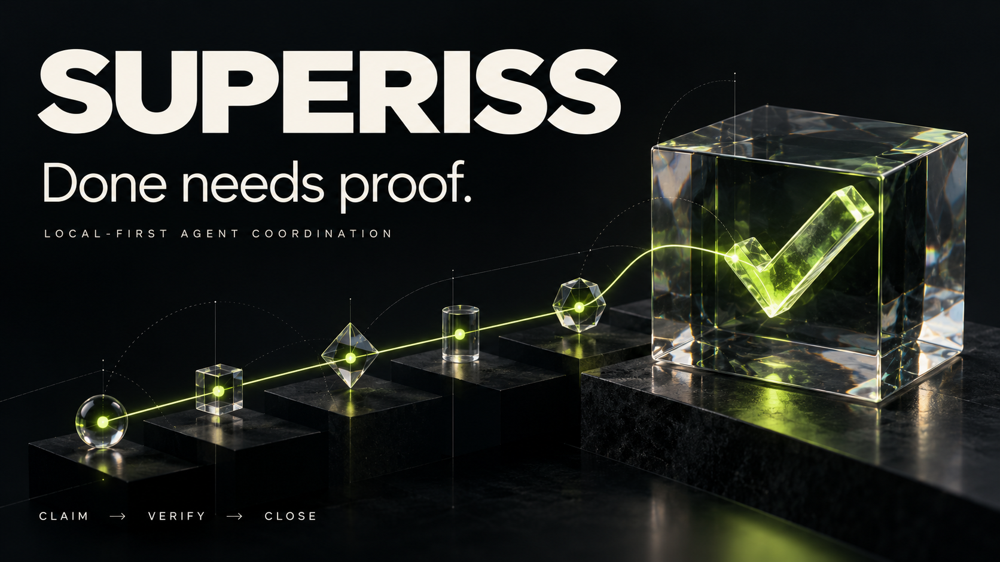

# Superiss — Fertig braucht einen Beleg.



**Lokale Aufgabenkoordination und dauerhaftes Arbeitsgedächtnis für KI-Agenten. Eine Beads-Alternative mit ausführbarer Abnahme, abgesicherten Claims und Wiederaufnahme.**

Superiss hält den Aufgabenstand samt Projektwissen in SQLite. Zum Abschluss führt der Agent den Prüfbefehl seines Vertrags aus. Danach verlangt Superiss einen gespeicherten Beleg. Claim und Lease müssen noch gelten; Vertragsrevision und Quellenhash müssen zum Beleg passen.

| Funktion | Nutzen |
| --- | --- |
| 🧠 Aufgaben und Arbeitsgedächtnis | Projektwissen überlebt den Chat. |
| 🧾 Ausgeführte Abnahme | Ohne passenden Proof kein Abschluss. |
| 🔒 Abgesicherte Ownership | Veraltete Worker können keinen neuen Stand abschließen. |
| 🗺️ Goals, Pläne und Dependencies | Aus Zielen werden ausführbare Teilaufgaben. |
| 🚦 Gates und Merge-Slots | Freigaben und gemeinsame Engstellen werden sichtbar. |
| 🔁 Checkpoints und Recovery | Wiederaufnahme prüft Zustand und Wiederholungsfreigaben. |
| 🔬 JUnit, Coverage und Reviewbelege | Zusätzliche Evidenz kann beim Abschluss Pflicht sein. |
| 💸 Kostenjournal und Rollups | Gemeldeter Verbrauch lässt sich je Goal auswerten. |
| 🔌 CLI, MCP, Socket und HTTP | Zugriff aus Terminal, Agent oder lokalem Browserboard. |
| ⚙️ Runner und Dienst | Begrenzter Command-to-Close-Ablauf mit macOS-Sandbox. |

**85 registrierte Operationen, Rust-Kern und Python-Referenz.** Der Tracker braucht keinen Modell-API-Key. Die Qualität des Prüfbefehls bestimmt, was ein grüner Beleg nachweist.

## Ausprobieren

```bash
git clone https://github.com/Supersynergy/superiss.git
cd superiss
CARGO_TARGET_DIR=.cache/cargo cargo build --locked -j2
python3 examples/quickstart.py
```

Das Beispiel nutzt eine private temporäre Datenbank. Es zeigt zuerst den abgelehnten Abschluss ohne Proof. Anschließend führt es die Prüfung aus und liest den belegten Abschluss zurück. [Voraussetzungen](docs/GETTING-STARTED.md).

Der [Vergleich mit fünf etablierten Tools](docs/COMPARISON.md) enthält eine Emoji-Tabelle für **Beads, beads_rust, Task Master AI, Vibe Kanban und Taskwarrior**, Primärquellen und deren Stärken. Stand: 23.10.2026. Offene Recherchepunkte sind markiert; es wurde kein Geschwindigkeitsvergleich gegen diese Tools ausgeführt.

[Alle Features](docs/FEATURES.md) · [Alle Operationen](docs/OPERATIONS.md) · [Beads-Migration](docs/BEADS-ALTERNATIVE.md) · [Protokoll](SPEC.md) · [Lokaler Ablauf](ZERO-RECOVERY.md) · [Dienst](SERVICE.md) · [Prüfbelege](docs/VALIDATION.md) · [English](README.md)

Pfadmetadaten sind keine Sandbox. Der explizite lokale macOS-Ablauf fügt eine Sandbox hinzu. Kostenjournal und Tokenzählung sind keine Providerrechnung. Lokale Tests belegen weder Produktionszuverlässigkeit noch 24 Stunden Verfügbarkeit. [MIT-Lizenz](LICENSE).
