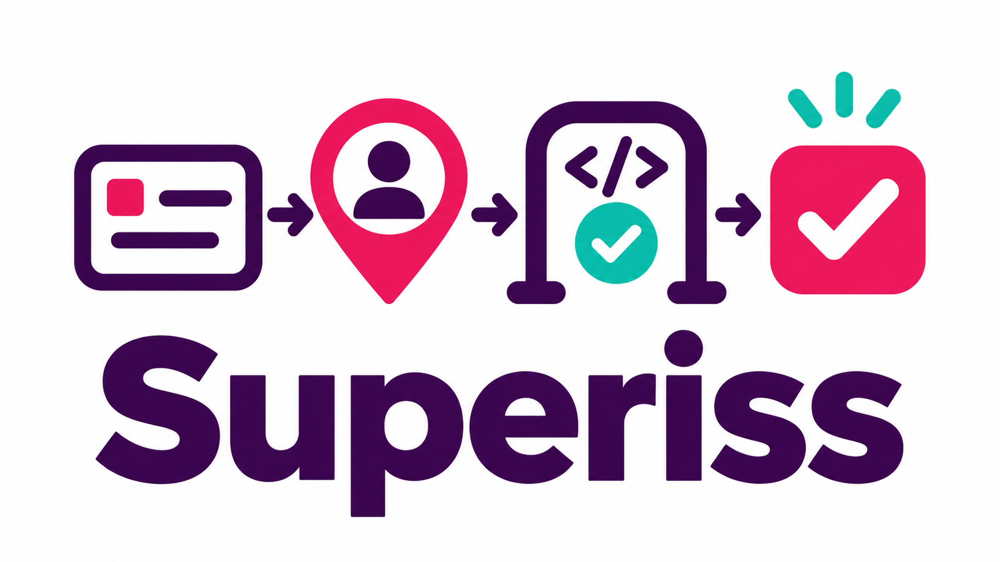

# Superiss



**Aufgabenkoordination für Coding-Agenten. „Fertig“ braucht einen bestandenen Prüflauf.**

Arbeit zuweisen, den Kontext für die Fortsetzung erhalten und das Ergebnis vor dem Abschluss prüfen. Superiss läuft lokal und verbindet sich über CLI oder MCP mit deinen Agenten.

[Version 1.3 laden](https://github.com/Supersynergy/superiss/releases/latest) · [Einrichten](docs/GETTING-STARTED.md) · [English](README.md)

## Wobei es hilft

- Parallele Agenten koordinieren. Claims halten fest, wer eine Aufgabe gerade bearbeitet. Lease und Epoch weisen Schreibversuche mit veralteter Zuständigkeit zurück.
- Abschluss prüfbar machen. Jede Aufgabe hat einen Prüfbefehl und einen Quellenumfang. Schließen geht mit einem bestandenen Beleg für den aktuellen Vertrag und die aktuellen Dateien.
- Nach Unterbrechungen fortsetzen. Checkpoints bewahren den Arbeitsstand und den nächsten sicheren Schritt. Resume liest den Zustand; der Claim wird ausdrücklich angefordert. [Sicher fortsetzen](docs/GETTING-STARTED.md#resume-an-interrupted-task).
- Ziele bis zur Wirkung verfolgen. WOOP plant Umsetzung → Auslieferung → Wirkung als getrennte Aufgaben mit eigenen Prüfungen. Planung startet keine Agenten und bestätigt keinen Kundenerfolg.

```text
Aufgabe → Claim → Arbeit → Prüfen → Abschluss mit Beleg
                     ↳ Checkpoint → Fortsetzen
```

## Den vollständigen Ablauf ausprobieren

Erforderlich sind **Bun ab 1.4.4** und Git. Die Demo nutzt zusätzlich Python 3.

```sh
git clone https://github.com/Supersynergy/superiss.git
cd superiss
python3 examples/quickstart.py
```

Die Demo verwendet eine temporäre Datenbank. Sie claimt eine Aufgabe, zeigt den abgewiesenen Abschluss ohne Beleg, führt den Prüfbefehl aus und liest den abgeschlossenen Zustand zurück. Deine Projekt-Stores bleiben unberührt.

## Mit dem eigenen Agenten verwenden

Den Agenten an eine vorhandene Projekt-Datenbank binden und den MCP-Server starten:

```sh
bin/sis mcp --db /absolutes/projekt/.sis/tasks.db
```

Die CLI verwendet dieselben Verträge und Belege. [Einrichtung und Upgrade](docs/GETTING-STARTED.md) erklären die Store-Anlage und Agentenkonfiguration sowie den Erhalt laufender Jobs beim Versionswechsel.

Der optionale Forge-Ablauf verbindet Claims mit Worktrees und PRs auf GitHub, Gitea oder Forgejo. [Forge-Anleitung](docs/SISF.md).

## Wann es passt

Für parallele Coding-Agenten, Aufgaben mit Unterbrechungen und Ergebnisse, die einen wiederholbaren Prüflauf brauchen. Für einfache Erinnerungen ohne Ausführung oder Übergabe genügt weiterhin eine To-do-Liste.

SQLite speichert den Aufgabenstand. Der Tracker braucht keinen Modell-API-Key. Ein Beleg gilt für seinen Prüfumfang; Actor-Namen sind keine Authentifizierung. [Unterstützung und Grenzen](docs/FEATURES.md).

[WOOP-Beispiel](docs/WOOP.md) · [Agentenanbindung](docs/V1-INTEGRATIONS.md) · [Prüfungen](docs/VALIDATION.md) · [Befehlskatalog](docs/OPERATIONS.md) · [MIT-Lizenz](LICENSE)
