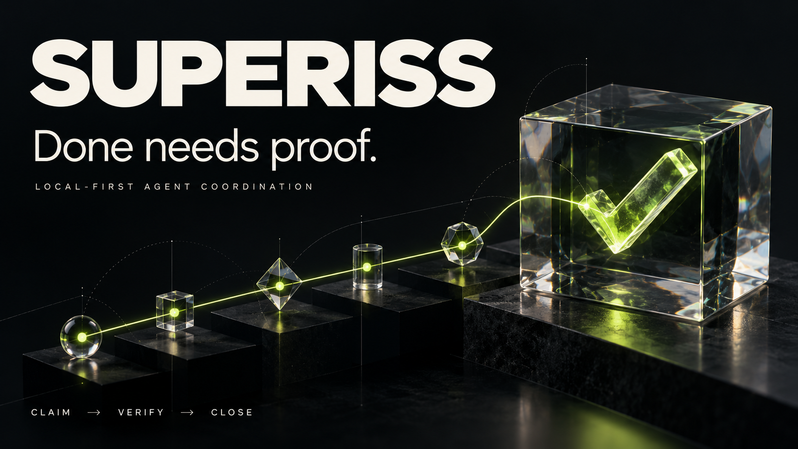

<p align="center"></p>

# Superiss 1.1

**Local-first agent coordination with source-bound acceptance and an integrated Git/forge workflow.**

Superiss stores tasks, goals, dependencies, project memory, checkpoints and evidence. An agent must hold the current claim and present a passing proof for the current contract and source files before closing a task.

Version **1.2.0** uses Bun/TypeScript and authoritative SQLite: **88 core operations plus 10 forge tools**. DuckDB 2 provides optional, separate snapshot analytics. The tracker needs no model API key.

[Get started](docs/GETTING-STARTED.md) · [Forge workflow](docs/SISF.md) · [Features](docs/FEATURES.md) · [Comparison](docs/COMPARISON.md) · [Deutsch](README.de.md) · [Validation](docs/VALIDATION.md)

Local 1.2 also retains [API/client/capsules and optional workflow/service adapters](docs/V1-INTEGRATIONS.md), durable Forge conflict reconciliation and [fork integration guidance](docs/FORGE-BRIDGES.md). Its source integrates GitHub main `2b200f3`; existing installed daemons are unchanged.

## Start

Install Bun **1.4.4 or newer**. Git is needed for forge operations. No runtime npm packages are required. Worktrunk is optional; GitHub operations additionally use an authenticated `gh`. Analytics requires an installed `run-guard` and DuckDB 2 shared library.

```sh
git clone https://github.com/Supersynergy/superiss.git
cd superiss
mkdir -p /absolute/project/.sis
export SIS_DB=/absolute/project/.sis/project.db
bin/sis up
bin/sis capabilities
# Separate terminal: native Git backend, local forge board and task watcher.
bin/sis forge serve --repo /absolute/project --port 8766
```

The forge board opens at `http://127.0.0.1:8766/forge`. `sis up` owns only the core daemon; the foreground forge process is stopped separately with Ctrl-C. To enable the core task board, set `SIS_HTTP=8765` when starting a new daemon.

## One checked workflow

```sh
bin/sis create '{"id":"auth","title":"Implement authentication","oracle_cmd":"bun test tests/auth.test.ts","allowed_paths":["src","tests"]}'
bin/sis acquire id=auth actor=worker-a ttl=1800
# Use the returned epoch; do not assume it is always 1.
bin/sis forge bind auth --actor worker-a --epoch 1
# Edit and stage files inside the returned worktree.
bin/sis forge git-commit auth --actor worker-a --epoch 1 --message "Implement authentication"
bin/sis forge record auth --actor worker-a --epoch 1
bin/sis forge verify auth --actor worker-a --epoch 1
# Keep heartbeating throughout the work. Inspect passed:true and the actual proof_id.
bin/sis forge push auth --actor worker-a --epoch 1
bin/sis forge pr auth --actor worker-a --epoch 1 --via github
bin/sis forge ci auth --actor worker-a --epoch 1 --via github
```

A PR workflow uses the forge's reviews and protected-branch merge. Separately, `sis forge merge` is an **explicit local fast-forward workflow**: it checks the proof, requires passing CI by default, acquires a merge slot, advances the clean local base and closes the task. It retains the worktree and branch and never pushes the base. `--skip-ci` explicitly permits a local workflow without CI; it never bypasses proof. Rebase and verify again if the base advanced. [Commands, cleanup and failure recovery](docs/SISF.md).

## Worktrunk and multiple repositories

Use `--backend worktrunk` on the forge process or set `backend` in `sisf.config.json`. Superiss remains responsible for task claims and bindings; Worktrunk handles the selected worktree operations. There is no fallback to Git if Worktrunk fails. Automated calls disable Worktrunk hooks and preserve the verified source commit during merge.

Configure a `repos` map and set a task's `meta.repo_key` to route it explicitly. This is routing within one project store; it is not distributed scheduling across machines.

## Agent interfaces

- Core: `bin/sis mcp --db /absolute/project.db`. `SIS_MCP_PROFILE=agent` exposes 13 selected worker tools; selection is enforced on calls.
- Forge: `bin/sis forge mcp --db /absolute/project.db --repo /absolute/project`. Ten tools share the CLI/HTTP workflow, ownership and proof rules.
- Compatibility: `mcp/sis-mcp.js` launches the current core MCP through Bun. `bin/sisf` aliases the current forge CLI; `bin/sis-v1` aliases the current core CLI.

## Build and upgrade

```sh
bun tools/check-v11.ts
bun tools/package-v1.ts /absolute/new-superiss-1.2.0
```

The relocatable package contains the core, forge CLI, both MCP entry points, tokenizers, task/forge boards, lifecycle helper, license and exact SHA-256 file manifest. The build refuses to overwrite its destination. Type checking requires installed TypeScript 7.1 and Node/Bun types; no dependencies are installed automatically.

A new installation does not migrate databases or replace daemons. A 1.1 client/forge refuses an older daemon before mutation. Stop the previous daemon using its own installation, retain that installation for rollback, test `migrate_copy` into a new database, then arrange the explicit cutover. [Upgrade and platform details](docs/GETTING-STARTED.md).

## Reference and limits

The retained Rust/Python **0.9 reference** is explicit: `sis reference …` or `SIS_IMPL=rs|py`. Its 85-operation registry is `ops.json`; the current registry is [packages/superiss/ops.json](packages/superiss/ops.json). macOS local-zero execution and launchd service remain reference-only and are not included in the 1.1 runtime bundle. [Version/support table](docs/FEATURES.md).

An oracle proves only what it checks. Actor names are not authentication. File scopes are not an OS sandbox. Recorded costs are observations, not invoices or pre-call spending authorization. Git, task state and remote PR writes are separate operations: interrupted or timed-out writes require reconciliation. Passing tests do not establish a production soak, independent security audit or competitor performance ranking.

[MIT license](LICENSE). Built by [Supersynergy](https://github.com/Supersynergy). The hero is conceptual artwork.
