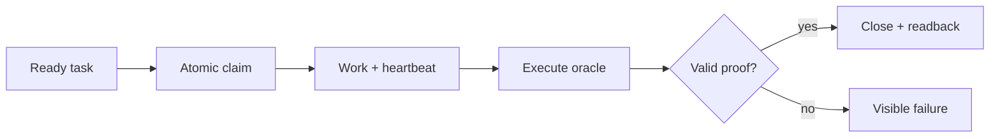

# What Superiss can do

Superiss 0.9.0 combines a persistent task graph with an executable acceptance contract. The shared [operation registry](../ops.json) contains **85 operations**. The [complete catalog](OPERATIONS.md) lists every one with its required inputs.

| Area | Capabilities | Practical use |
| --- | --- | --- |
| 🧠 Durable work and memory | Tasks, labels, priorities, search, notes, history, `remember` / `recall` | Recover project facts and unfinished work after a session reset. |
| 🗺️ Goal planning | Goals, subtasks, atomic plans, templates, dependency validation, subtree progress | Turn an outcome into executable leaves with a separate final acceptance. |
| 🚦 Readiness | Typed blockers, named gates, deferred work, goal/lane filters | Select eligible work without bypassing dependencies or approval gates. |
| 🔒 Ownership | Atomic claims, actor + epoch + expiring lease, heartbeat, cancellation | Reject stale workers when a newer claim owns the task. |
| 🧾 Acceptance | Executed oracle, bounded output/time, contract revision, source fingerprint, stored proof | Refuse close when the proof is missing, stale or bound to different sources. |
| 🔬 Additional evidence | JUnit, coverage thresholds, command runs, smoke/artifact/custom receipts | Require selected evidence kinds and optional separate-review receipts at close. |
| 🔁 Recovery | Checkpoint, resume, fenced handoff, replay flags, delivery leases and idempotency | Resume known state and stop when an interrupted effect is uncertain. |
| 🛤️ Coordination | Merge slots, event cursors, attribution of dirty files, atomic batches | Coordinate workers while keeping ownership and changes visible. |
| 💸 Cost records | Observed token/currency ledger, subtree rollups, budget checks | Audit recorded consumption; reject close above a configured budget. |
| 📊 Learning and traces | Pass-rate/cost/time aggregates, time filters, request spans | Inspect observed outcomes without inventing productivity or billing data. |
| 🔌 Interfaces | JSON CLI, Unix socket, MCP, loopback HTTP, local browser board | Integrate with agent hosts or use scripts and the terminal directly. |
| 📦 Exchange | JSONL snapshots, export/import, conflict-aware store sync, Beads-format exchange | Keep task state inspectable and migrate an explicitly selected export. |
| ⚙️ Local execution | Opt-in `sis run`, macOS sandbox, zero-budget contract, bounded service | Execute local jobs through run → verify → close with recovery checkpoints. |
| 🛡️ Service lifecycle | Foreground mode, pause/resume, owned launchd installation, watchdog, bounded restarts | Supervise local workers and preserve foreign processes. |

## Completion is a checked transition

The close operation checks ownership, a live lease, contract revision, source fingerprint and the saved proof. Optional review, attestation and budget requirements add further checks. A changed source invalidates the old proof. Goal containers need final acceptance after their descendants close.

## Architecture

The Rust implementation and Python reference share the registry, SQLite schema and protocol. SQLite uses WAL with `synchronous=FULL` by default. A deterministic JSONL mirror is written after committed mutations unless explicitly disabled. General CLI use can access SQLite directly; repeated requests can reuse the project-bound Unix socket.

The MCP worker profile exposes twelve operations. The full profile exposes the registry. The local HTTP interface provides a browser board, health and bounded event reads. HTTP is a local interface rather than a hosted collaboration product.

## Execution and service

`sis run` is an explicit local command workflow, not an autonomous coding model. Its macOS mode requires an exactly zero budget and a local-only execution contract, removes inherited credentials, denies networking and confines writes to the job directory. Protected source inputs must remain unchanged; outputs live outside their fingerprint scope.

`sis service` supervises eligible direct children of one goal. Current defaults: one-second polling, four local workers, ten seconds per command, a sixty-second workflow deadline and at most three configured restarts. Worker concurrency is bounded to 1–16. The optional host-quota preview does **not** authorize or dispatch model calls. [Service details](../SERVICE.md) and [recovery boundaries](../ZERO-RECOVERY.md).

## Limits that matter

- A passing oracle proves the behavior it actually checks. It cannot repair a weak acceptance contract.
- General `allowed_paths` metadata is a source scope, not an OS sandbox. The sandbox belongs to the explicit macOS local workflow.
- Recorded costs require trustworthy inputs. A close-time budget gate is not a pre-call provider spending control.
- Delivery fencing and idempotency do not guarantee exactly-once effects for arbitrary external commands.
- Smoke/artifact observations and reviewer identities are supplied by the host. They are not authenticated external audits.
- Token counts are local counts or labelled bounds, never a provider invoice.
- There is no built-in paid model provider, global optimal scheduler or autonomous self-modification.
- The included soak tooling can require 86,400 elapsed seconds. Shipping that tooling is not evidence of 24-hour availability.
